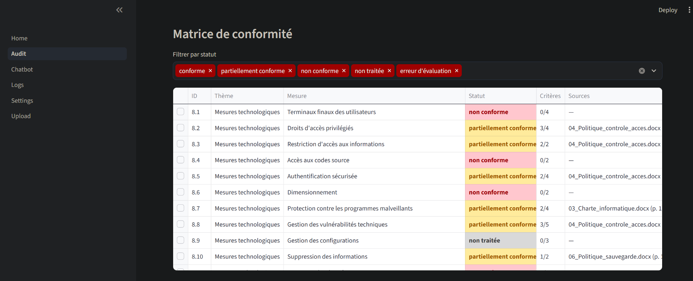
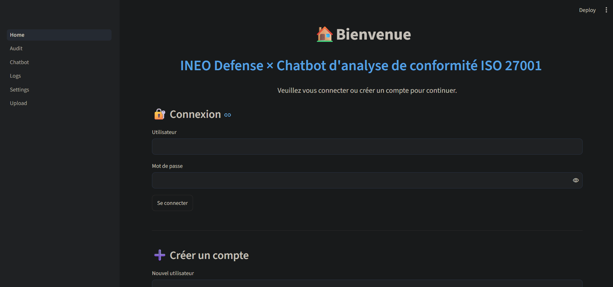
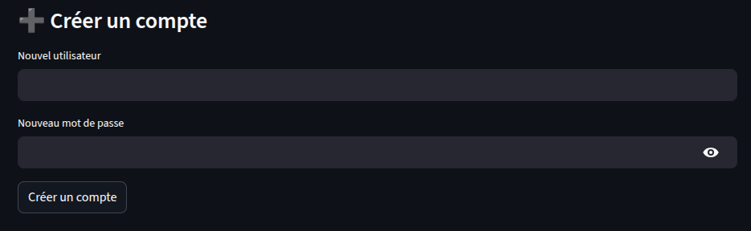
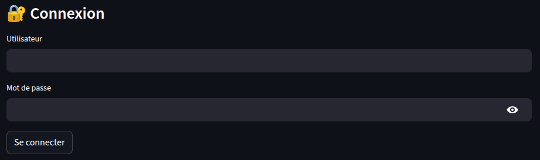
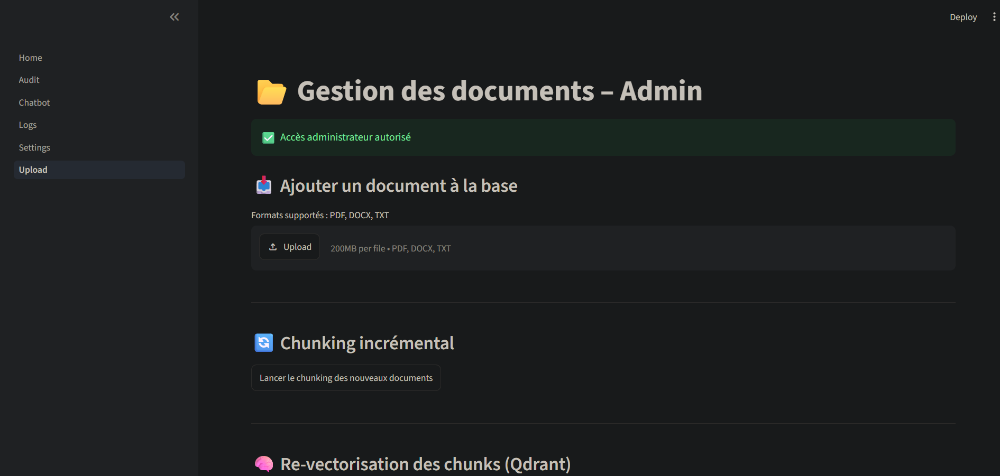
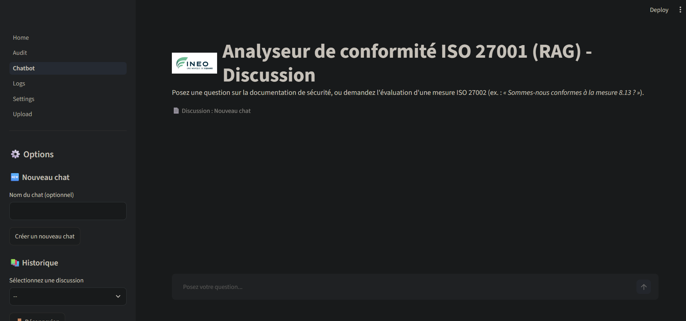
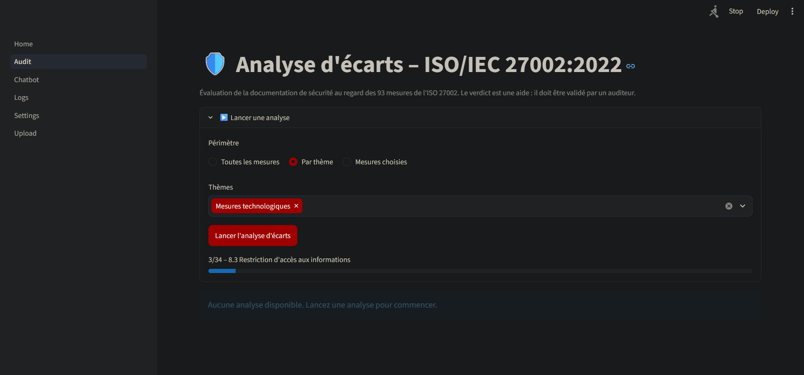

# **Assistant de conformité ISO 27001 / 27002 – RAG et analyse d'écarts**

## **Objectif du projet**



Dans une démarche de conformité (ISO 27001, NIS2, RGPD), un consultant ou un RSSI doit vérifier si la documentation de sécurité d'une organisation (PSSI, politiques, procédures, PCA/PRA, analyse de risques…) couvre bien les exigences du référentiel. Ce travail, appelé **analyse d'écarts** (*gap analysis*), est long et répétitif : pour chacune des 93 mesures de l'ISO/IEC 27002:2022, il faut retrouver les passages pertinents, juger s'ils suffisent et justifier chaque conclusion par une source.

Ce projet automatise la première passe de ce travail :

- **Interroger la documentation** en langage naturel (« Combien de temps conserve-t-on les sauvegardes ? ») et obtenir une réponse extraite des documents, toujours accompagnée de ses sources.
- **Évaluer une mesure ISO 27002** (« Sommes-nous conformes à la mesure 8.13 ? ») critère par critère, avec preuves, constats, écart et recommandation.
- **Lancer une analyse d'écarts complète** sur les 93 mesures et produire une **matrice de conformité** (taux de conformité, vue par thème et par article NIS2, export Excel).

**Principe directeur : aucun verdict sans source.** Chaque affirmation est rattachée à un document et à un extrait exact, vérifié automatiquement, pour qu'un auditeur humain puisse la contrôler. L'outil est une aide : le verdict final reste celui de l'auditeur.

Ce projet a été réalisé dans le cadre d’un **projet industriel mené en collaboration avec Ineo Defense**. Il vise à exploiter une base documentaire interne afin de faciliter l’**analyse de conformité dans une démarche GRC** (*Gouvernance, Risques et Conformité*), en s’appuyant notamment sur le référentiel ISO 27002, les pratiques d’audit et l’élaboration de matrices de conformité.

### **Jeu de test**

Le projet est démontré sur la documentation d'une entreprise **fictive**, *Armor Logistique SAS* (transport et entreposage, 480 salariés, entité importante au sens de NIS2) : 16 documents (PSSI, organisation, charte, politiques de contrôle d'accès, de classification, de sauvegarde, de journalisation, procédure d'incidents, PCA/PRA, analyse de risques, déclaration d'applicabilité, revue de direction…). Des écarts y ont été placés volontairement afin de mesurer si l'outil les détecte.

---

## **I. Architecture générale**

Le projet repose sur une architecture modulaire conçue pour le traitement, l'indexation et l'interrogation de documents via un pipeline de Retrieval-Augmented Generation (RAG).
Il est structuré autour de quatre composants fonctionnels distincts :

- **Chunking** : module chargé de la lecture des documents (PDF, DOCX, TXT) et de leur découpage en **sections** (un titre et le texte qui le suit), puis en segments exploitables par la recherche. Le découpage est réalisé par le code, sans modèle de langage : le texte d'origine n'est jamais modifié, ce qui permet de vérifier ensuite les citations mot pour mot.
- **Embedding & Retrieval** : composant responsable de la vectorisation des segments, de leur indexation dans une base vectorielle Qdrant, ainsi que de la recherche sémantique et du re-ranking des résultats à l'aide d'un modèle cross-encoder.
- **Compliance (audit)** : référentiel ISO/IEC 27002:2022 structuré (93 mesures, 285 critères vérifiables, lien avec les articles de NIS2), moteur d'évaluation d'une mesure, contrôle automatique des réponses du modèle, calcul des taux de conformité et export Excel.
- **Application (App)** : interface utilisateur développée avec Streamlit, permettant l'upload de documents, l'interaction avec le chatbot, l'analyse d'écarts et la consultation de l'historique des échanges.

| Rôle | Modèle | Exécution |
|---|---|---|
| Réponses du chatbot | Mistral 7B (`open-mistral-7b`) | API Mistral |
| Embeddings | `BAAI/bge-m3` | Local |
| Re-ranking | `BAAI/bge-reranker-v2-m3` | Local |

Aucun modèle de langage n'est téléchargé ni exécuté en local. Les modèles d'embedding et de re-ranking restent exécutés localement.

L'ensemble de l'infrastructure est entièrement conteneurisé via Docker, garantissant la reproductibilité des environnements, l'isolation des services et la facilité de déploiement.

### **I.1. Fonctionnement du chatbot**

Le chatbot choisit automatiquement son mode selon la question :

- **Mode question** (par exemple « Quelle est la politique de télétravail ? ») : la question est vectorisée, les passages les plus proches sont recherchés dans Qdrant puis re-classés par le cross-encoder. Le LLM répond **uniquement** à partir de ces passages et les sources sont ajoutées par le code. Si aucun passage n'est assez pertinent, le LLM n'est pas appelé et l'outil répond que l'information n'apparaît pas dans les documents.
- **Mode audit** (la question cite une mesure : « 8.13 », « 8-13 », « mesure 8 13 » ou son titre exact) : la mesure est évaluée selon le fonctionnement décrit en section III.

Chaque question est traitée indépendamment : l'historique est affiché et sauvegardé, mais il n'est pas renvoyé au modèle, afin qu'une ancienne réponse ne puisse jamais servir de source.

---

## **II. Pour lancer le projet**

### **II.1. Configuration de la clé API Mistral**

Le projet nécessite une clé API Mistral (à créer sur la console Mistral : https://console.mistral.ai).

- Renseignez votre clé dans le fichier `.env` :
```bash
MISTRAL_API_KEY=votre_cle_api
LLM_RAG=open-mistral-7b
LLM_AUDIT=mistral-small-latest
```

### **II.2. Démarrage des conteneurs Docker :**

```bash
sudo docker compose up
```

#### **💡 Remarques :**
- Cette commande démarre le conteneur Qdrant (base vectorielle) et le conteneur de l'Agent (application Streamlit).
- Aucun modèle de langage n'est téléchargé : les appels sont envoyés à l'API Mistral. Une connexion Internet est donc nécessaire.
- ⚠️ **Première exécution** : le premier lancement du chatbot ou de l'agent peut prendre **plusieurs minutes**, car les modèles d'Embedding et de ré-ranking doivent être téléchargés depuis Hugging Face dans le conteneur. Les exécutions suivantes seront beaucoup plus rapides.
- Une fois l'Agent démarré, vous verrez dans les logs le message :
```bash
✅ Qdrant est prêt
🚀 Services prêts, démarrage de l'Agent...
```

### **II.3. Première configuration et utilisation**

#### **Étape 1 : Accéder à l'interface**
- Ouvrez votre navigateur et allez à l'URL suivante : http://localhost:8501
- Attendez pour que l'interface se charge complètement.



#### **Étape 2 : Créer un utilisateur administrateur**
- Sur la page d'accueil, vous verrez une interface de connexion.
- Cliquez sur "Créer un compte".
- Créez un compte administrateur avec :
    - Nom d'utilisateur admin
    - Mot de passe sécurisé



- Pourquoi créer un admin ? L'administrateur est le seul utilisateur qui peut :
    - Ajouter des documents
    - Lancer le chunking des documents
    - Effectuer l'indexation
    - Lancer une analyse d'écarts (chaque mesure évaluée appelle l'API)

#### **Étape 3 : Se connecter en tant qu'admin**
- Utilisez les identifiants que vous venez de créer pour vous connecter.



#### **Étape 4 : Uploader des documents**
- Dans la barre latérale (sidebar), cliquez sur "Upload"
- Vous verrez l'interface d'ajout de documents



#### **Étape 5 : Ajouter des documents**
- Cliquez sur "Browse files"
- Sélectionnez les documents que vous souhaitez ajouter à la base de données (par exemple les 16 documents d'Armor Logistique)
- Une fois les fichiers sélectionnés, confirmez l'ajout en cliquant sur le bouton approprié

#### **Étape 6 : Lancer le chunking**
- Après confirmation de l'ajout, cliquez sur le bouton : "Lancer le chunking des nouveaux documents"
- Ce processus découpe chaque document en sections (titre et contenu), puis en segments, sans modifier le texte. Il ne fait appel à aucune API et ne prend que quelques secondes.

#### **Étape 7 : Re-vectoriser les chunks**
- Une fois le chunking terminé, cliquez sur : "Re-vectoriser tous les chunks"
- Cette étape crée les embeddings et indexe les documents dans la base vectorielle (envoi à Qdrant par paquets)

#### **Étape 8 : Utiliser le chatbot**
- Retournez dans le sidebar et cliquez sur "Chatbot"
- Vous pouvez maintenant communiquer avec votre chatbot
- Posez des questions basées sur les documents que vous avez uploadés, par exemple :
    - « Combien de temps garde-t-on les sauvegardes ? »
    - « Sommes-nous conformes à la mesure 8.13 ? »



#### **Étape 9 : Lancer une analyse d'écarts**
- Dans le sidebar, cliquez sur "Audit"
- Ouvrez « Lancer une analyse » et choisissez le périmètre : toutes les mesures, un thème (organisationnel, personnes, physique, technologique) ou une sélection de mesures
- Cliquez sur « Lancer l'analyse d'écarts » ; la barre de progression indique la mesure en cours
- Consultez les résultats et téléchargez la matrice de conformité (voir section III)



#### **Étape 10 (Optionnelle) : Créer d'autres utilisateurs**
- Vous pouvez vous déconnecter (bouton "Déconnexion")
- Créer un nouveau compte utilisateur standard
- Vous connecter avec ce nouveau compte
- Le chatbot et la consultation des analyses seront également accessibles pour cet utilisateur, mais sans les privilèges d'administration

---

## **III. Analyse d'écarts (audit ISO 27002)**

### **III.1. Le référentiel**

Le fichier `Compliance/referentiel_iso27002.json` décrit les **93 mesures de l'ISO/IEC 27002:2022** (37 organisationnelles, 8 liées aux personnes, 14 physiques, 34 technologiques). Pour chaque mesure, il contient :
- son identifiant, son thème et son titre ;
- une requête de recherche (mots-clés utilisés pour retrouver les passages pertinents) ;
- des **critères vérifiables** (285 au total), par exemple pour la mesure 8.13 – Sauvegarde : fréquence définie, durées de conservation définies, copie hors site et hors ligne ou immuable, sauvegardes protégées, tests de restauration réalisés et tracés ;
- les articles de **NIS2** auxquels elle contribue (68 mesures liées à l'article 21).

### **III.2. Évaluation d'une mesure, étape par étape**

1. **Préparation (code)** : la fiche de la mesure et ses critères sont lus dans le référentiel.
2. **Recherche (code et modèles BGE)** : la requête de la mesure est vectorisée ; les 30 passages les plus proches sont re-classés par le cross-encoder ; les 6 meilleurs au-dessus du seuil de pertinence sont conservés.
3. **Aucun passage pertinent** : la mesure est classée **non traitée**, sans appel au modèle de langage.
4. **Jugement (LLM)** : le modèle reçoit la mesure, ses critères et les passages (traités comme des données, jamais comme des instructions). Pour chaque critère, il indique s'il est couvert et cite **mot pour mot** la phrase qui le prouve, ou la phrase qui montre l'écart (« prévu », « à définir »…). Il rédige ensuite l'écart et une recommandation.
5. **Contrôle (code)** : chaque citation est vérifiée. Le passage cité doit exister et la phrase doit s'y trouver. Une citation introuvable est rejetée et le critère redevient non couvert. Le statut est ensuite **recalculé à partir des seules preuves validées**, et le plus sévère entre ce calcul et l'avis du modèle est conservé. Toute correction est tracée dans les « contrôles automatiques ».
6. **Résultat** : statut, critères couverts et manquants, preuves, constats, sources, écart et recommandation.

| Statut | Règle |
|---|---|
| 🟢 Conforme | Tous les critères sont prouvés par un extrait vérifié |
| 🟠 Partiellement conforme | Une partie des critères est prouvée |
| 🔴 Non conforme | La documentation traite le sujet, mais aucun critère n'est prouvé |
| ⚪ Non traitée | Aucun passage de la documentation ne traite la mesure |
| 🟣 Erreur d'évaluation | Réponse du modèle inexploitable (exclue des taux) |

Une mesure seulement « prévue » ou « en cours » n'est jamais considérée comme mise en œuvre.

### **III.3. Analyse complète et indicateurs**

La page **Audit** répète cette évaluation sur le périmètre choisi, puis calcule :
- le **taux de conformité** = mesures conformes ÷ mesures évaluées ;
- le **taux pondéré** = (conformes + ½ × partiellement conformes) ÷ mesures évaluées ;
- ces mêmes taux **par thème** et **par article NIS2**.

Les résultats sont sauvegardés (JSON horodaté dans `Compliance/resultats/`) et rechargés à l'ouverture de la page. La page affiche la matrice de conformité filtrable par statut et, au clic sur une mesure, son détail : critères, preuves, constats, sources, écart et recommandation.

### **III.4. Export Excel**

Le bouton « Télécharger la matrice de conformité » produit un classeur de 4 onglets :
- **Synthèse** : taux globaux et par thème ;
- **Matrice** : une ligne par mesure, statut en couleur, critères, écart, recommandation, sources ;
- **Preuves et constats** : une ligne par citation (mesure, critère, document, page, extrait) ;
- **Vue NIS2** : taux par article de la directive.

### **III.5. Exemple de résultat**

Mesure **8.13 – Sauvegarde des informations**, sur la documentation d'Armor Logistique :

- 🟠 **Statut : partiellement conforme**
- ✅ Fréquence des sauvegardes : *« Base de données du TMS : sauvegarde complète chaque nuit… »* (06_Politique_sauvegarde.docx)
- ✅ Durées de conservation : *« Sauvegardes quotidiennes : 30 jours. Sauvegardes hebdomadaires : 3 mois… »* (06_Politique_sauvegarde.docx)
- ❌ Copie hors ligne ou immuable : la seule copie est répliquée vers un second site, et le serveur de sauvegarde est membre du domaine Active Directory (06_Politique_sauvegarde.docx)
- ❌ Tests de restauration : aucun test réalisé ni tracé
- **Recommandation** : mettre en place une copie hors ligne ou immuable, isoler le serveur de sauvegarde de l'annuaire, réaliser et tracer des tests de restauration réguliers.

### **III.6. Limites**

- L'outil évalue la **documentation**, pas la réalité technique : une politique bien écrite mais non appliquée peut apparaître conforme.
- Le jugement reste celui d'un modèle de langage ; le contrôle des citations empêche les preuves inventées, mais pas toutes les erreurs d'interprétation. Le verdict doit être validé par un auditeur.
- La déclaration d'applicabilité mentionne toutes les mesures : une mesure seulement déclarée « mise en œuvre », sans politique associée, est classée non conforme plutôt que non traitée.